# E OS

Sistema operacional leve baseado em Linux, no modelo do ChromeOS: simples, rápido e feito para máquinas com pouca memória. A meta é rodar apps Linux, Android e Windows no mesmo sistema.

> **Estado:** E OS 0.2, com a interface gráfica **Fusão** e um instalador gráfico com a cara do E OS. A ISO para PCs x86-64 dá para experimentar sem instalar ou instalar no disco. Veja o [roteiro](docs/ESPECIFICACAO.md#8-roteiro).

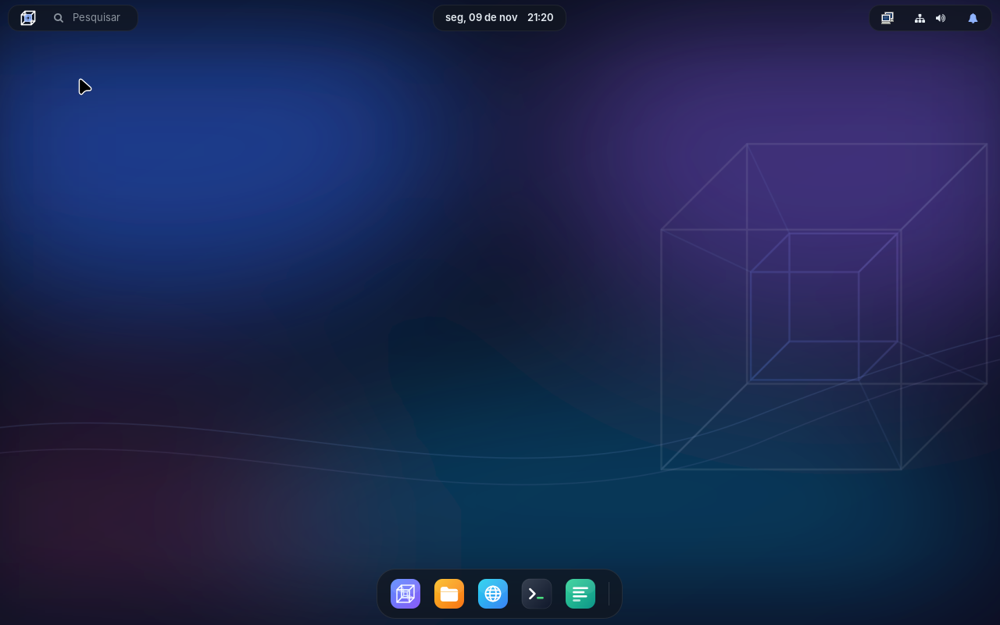

## A interface Fusão

Uma interface moderna e minimalista que junta o que cada sistema faz de melhor:

| Inspiração | O que entrou no E OS |
|---|---|
| macOS | Dock flutuante no centro, menu do sistema no logo, busca no estilo do Spotlight, botões redondos coloridos |
| Windows 11 | Botão Início no dock, cantos arredondados, transparência, botões das janelas à direita |
| Android | Painel rápido com blocos e controles, notificações em cartões |
| ChromeOS | Status (rede, som, bateria) numa "pílula" que abre o painel rápido, busca em primeiro lugar |
| Linux Mint | Familiaridade: gerenciador de arquivos, menu no botão direito, atalhos de teclado |

O logo do E OS é um **tesserato**, o hipercubo de 4 dimensões: um cubo dentro de outro, com os vértices ligados.

Com a interface aberta, a sessão live ocupa uns 180 MB de memória e deixa uns 630 MB livres para apps numa máquina de 1 GB (medido no QEMU).

### Atalhos

| Atalho | O que faz |
|---|---|
| Super + Espaço | Busca de apps |
| Super + A | Painel rápido e notificações |
| Super + E | Arquivos |
| Super + Enter | Terminal |
| Super + B | Navegador |
| Super + L | Bloqueia a tela |
| Super + setas | Maximiza, minimiza e encaixa a janela na metade da tela |
| Alt + Tab | Troca de janela |
| Print | Captura a tela para a pasta Imagens |

### Telas

| | |
|---|---|
| 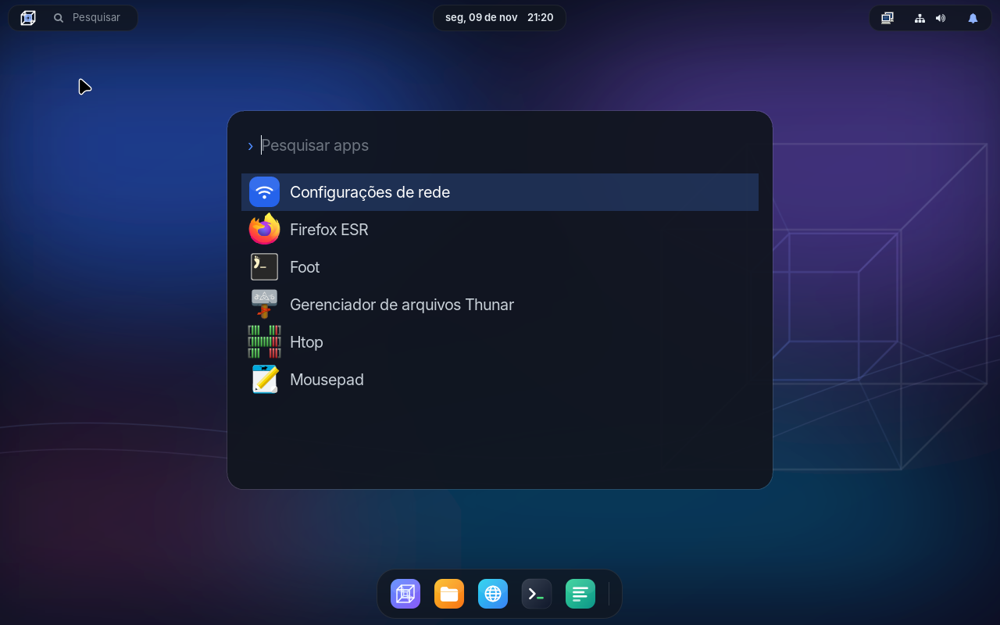 | 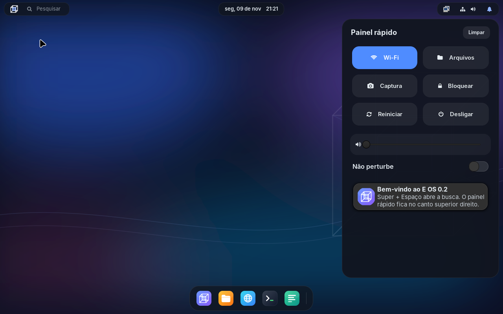 |
| Busca (Super + Espaço) | Painel rápido (Super + A) |
| 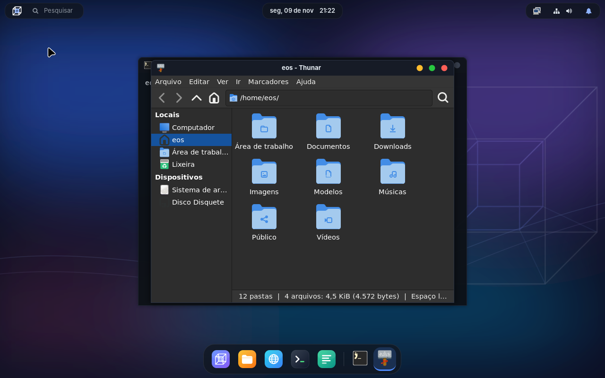 | 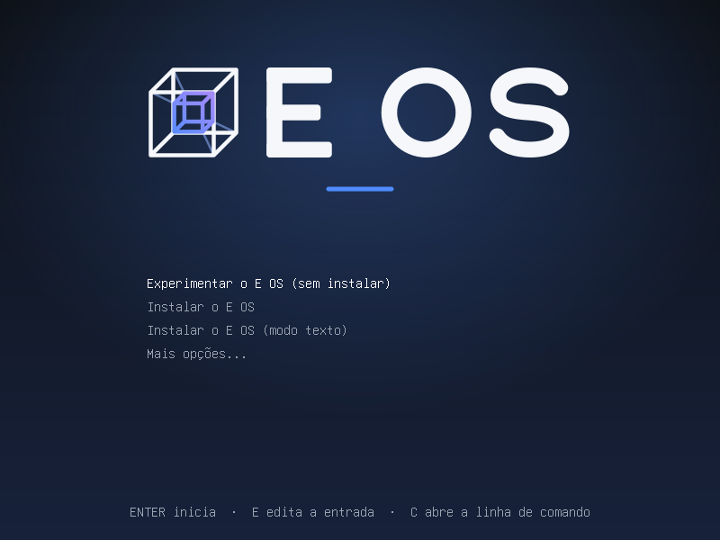 |
| Janelas e dock com os apps abertos | Menu de boot |

## Gerar a ISO

Você precisa de:

- Windows 10/11 com [Docker Desktop](https://www.docker.com/products/docker-desktop/), ou Linux com Docker;
- uns 15 GB livres em disco;
- internet, porque o build baixa os pacotes e o instalador do Debian.

No Windows, abra o PowerShell na pasta do projeto e rode:

```powershell
.\eos.cmd build
```

No Linux:

```bash
./eos.sh build
```

A ISO sai em `out/eos-0.2-amd64.hybrid.iso` (cerca de 1 GB). O primeiro build leva uns 20 minutos. Os seguintes são mais rápidos, porque reaproveitam os pacotes já baixados.

## Experimentar ou instalar

Grave a ISO num pendrive com o [Rufus](https://rufus.ie) ou o [Ventoy](https://www.ventoy.net), ou abra no VirtualBox ou no VMware. O menu de boot tem:

| Opção | O que faz |
|---|---|
| Experimentar o E OS (sem instalar) | Liga o sistema direto do pendrive, já na interface Fusão, sem mexer no disco. Usuário `eos`, senha `live`. Por aqui também se instala o E OS. |
| Instalar o E OS | Instalador do Debian, para instalar sem abrir a interface |
| Instalar o E OS (modo texto) | O mesmo instalador em modo texto, que precisa de menos memória |
| Mais opções | Modo seguro, reparo de um sistema instalado e, no UEFI, configurações do firmware |

### Pela interface (recomendado)

Escolha **Experimentar o E OS** e, na área de trabalho, clique em **Instalar o E OS**, o primeiro ícone do dock (ou procure "Instalar" na busca). O instalador gráfico, com a cara do E OS, pergunta:

1. **Bem-vindo:** o idioma (Português do Brasil já vem selecionado);
2. **Localização:** o fuso horário no mapa (São Paulo já vem marcado) e o formato de números e datas;
3. **Teclado:** modelo e layout, com um campo para testar;
4. **Partições:** formatar o disco inteiro ou particionar à mão, com a opção de criptografar o sistema;
5. **Usuários:** seu nome, usuário, nome do computador e senha (esse usuário administra o sistema com `sudo`);
6. **Resumo:** tudo o que vai ser feito, para conferir antes de começar.

> **Atenção:** "Formatar o disco" apaga tudo o que estiver no disco escolhido.

Enquanto copia o sistema, o instalador mostra dicas da interface Fusão. No fim, deixe marcado **Reiniciar agora**, clique em **Concluído** e tire o pendrive.

| | |
|---|---|
| 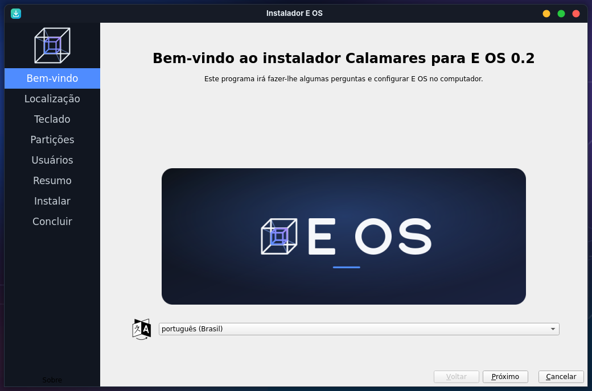 | 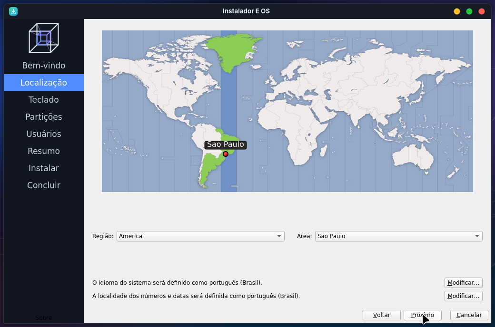 |
| Boas-vindas | Localização |
| 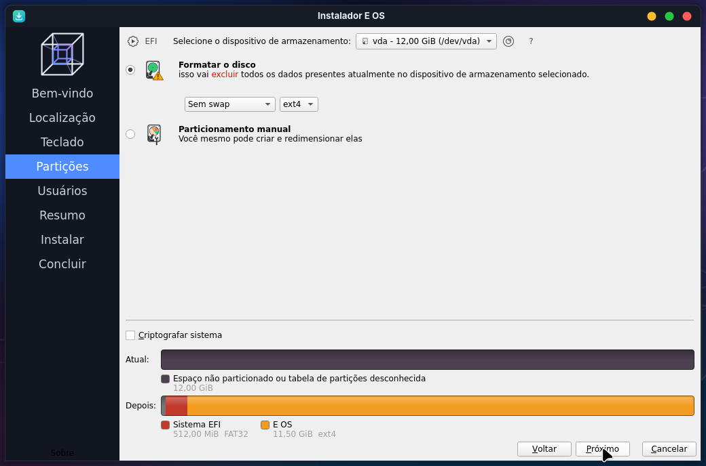 | 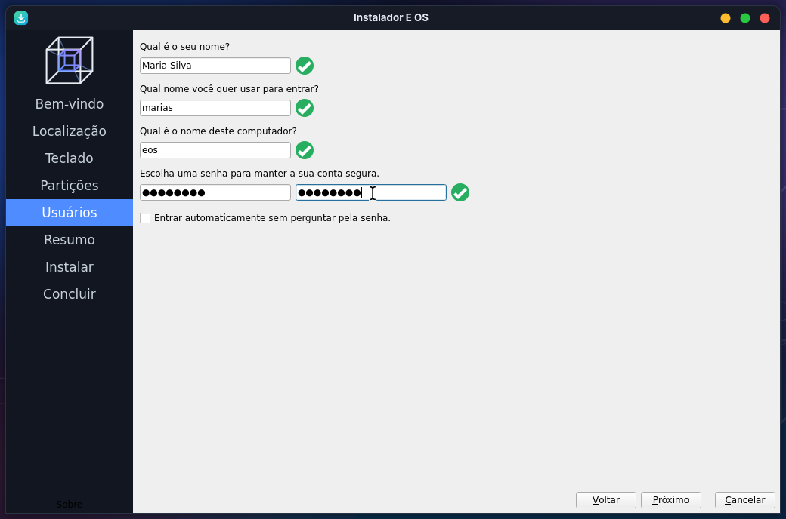 |
| Partições | Usuários |
| 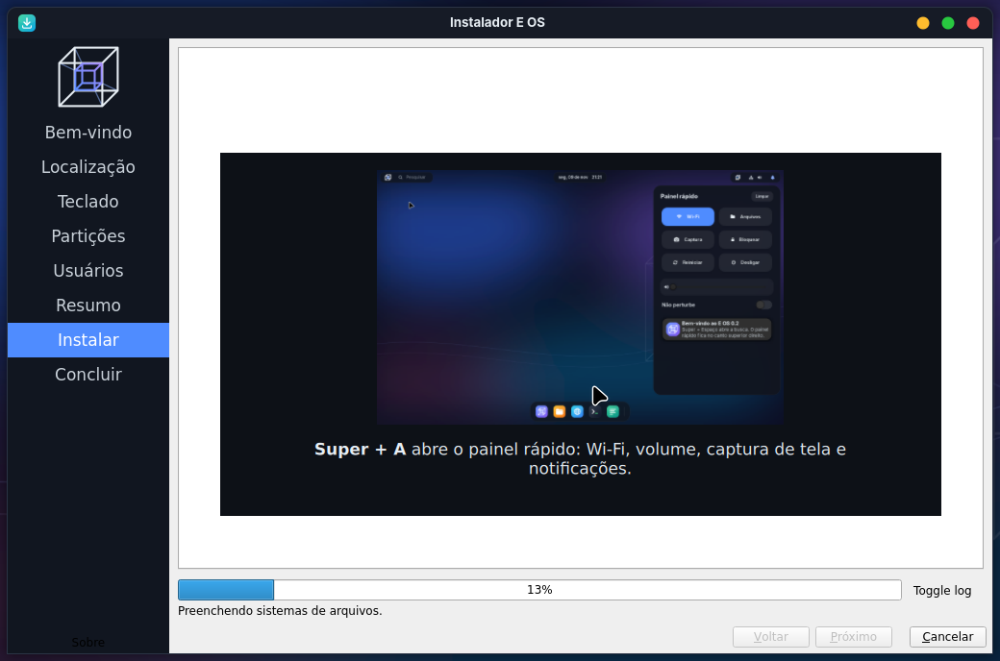 | 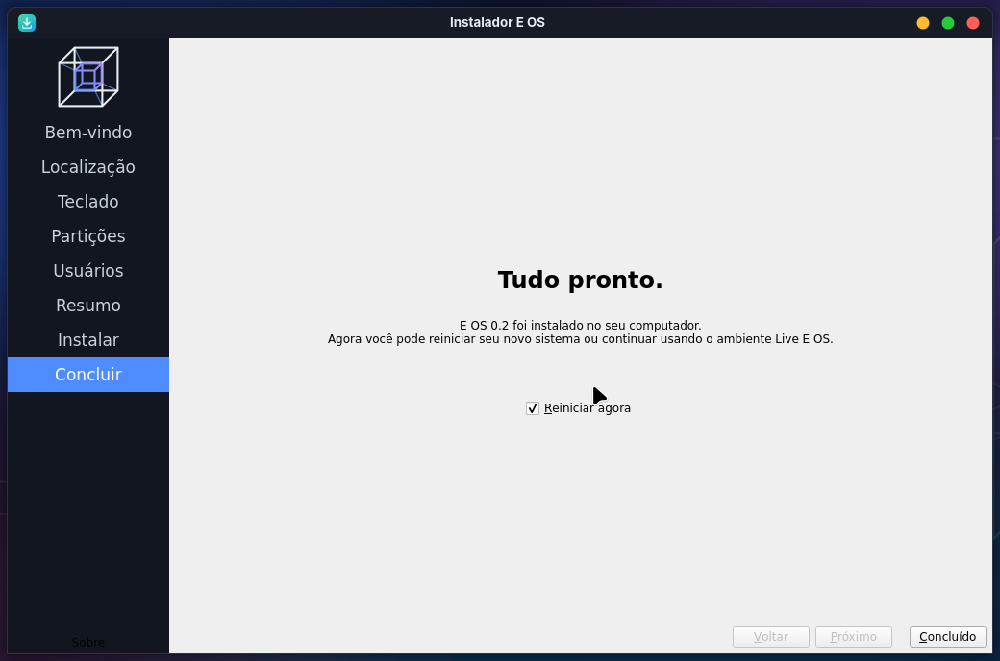 |
| Instalando, com dicas da interface | Tudo pronto |

### Pelo menu de boot

As opções **Instalar o E OS** do menu de boot abrem o instalador do Debian, em modo gráfico ou texto, sem carregar a interface. Ele pergunta, nesta ordem:

1. idioma (Português do Brasil já vem selecionado);
2. região;
3. teclado;
4. nome da máquina;
5. seu nome, usuário e senha (esse usuário administra o sistema com `sudo`);
6. fuso horário;
7. onde instalar: disco inteiro, disco inteiro com LVM, disco inteiro com LVM criptografado, ou particionamento manual;
8. só em PCs com BIOS: em qual disco gravar o carregador de boot (GRUB).

> **Atenção:** as opções de "disco inteiro" apagam tudo o que estiver no disco escolhido.

No fim, tire o pendrive e reinicie.

| | |
|---|---|
| 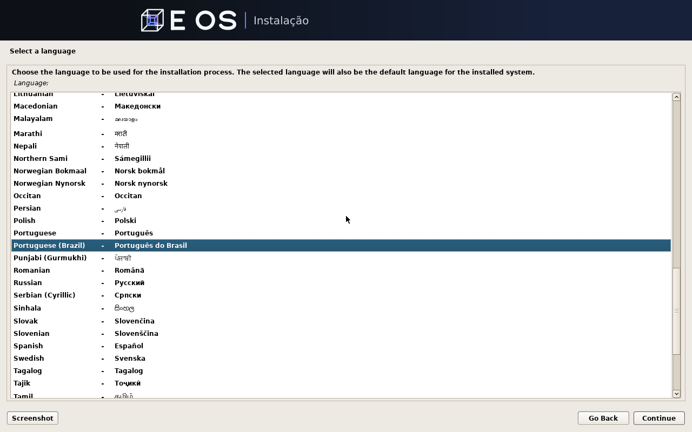 | 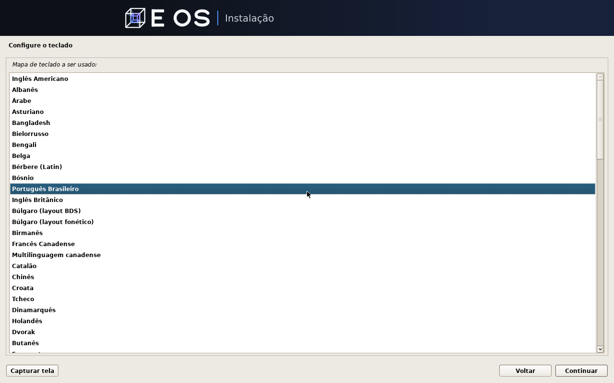 |
| Idioma | Teclado |
| 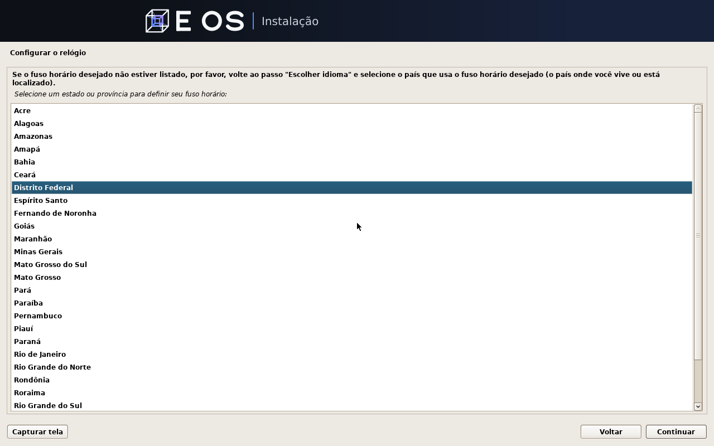 | 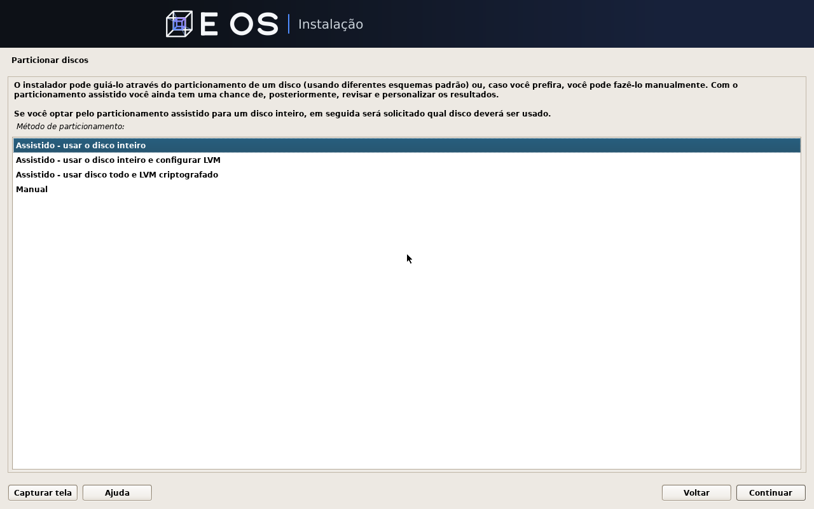 |
| Fuso horário | Onde instalar |

### Depois de instalar

No sistema instalado, entre com seu usuário no primeiro terminal e a interface abre sozinha.

O instalador gráfico foi testado no QEMU com 1 GB de memória, em BIOS e em UEFI, inclusive com o Secure Boot ligado.

Os dois instaladores copiam o próprio E OS da ISO para o disco, então funcionam sem internet. Quando usam o disco inteiro, eles criam a partição EFI se o PC for UEFI e não criam partição de swap: o E OS usa zram, uma swap comprimida na própria memória. Precisa de um disco de pelo menos 8 GB.

## Testar

```powershell
.\eos.cmd test
.\eos.cmd install-test
```

- `test` liga a ISO no QEMU, sem janela e com 1 GB de RAM, em modo BIOS e em modo UEFI. Ele entra no sistema, confere a interface, a memória, a rede e os serviços, e desliga. Os relatórios ficam em `out/teste-bios.log` e `out/teste-uefi.log`.
- `install-test` instala o E OS pelo instalador do menu de boot num disco virtual de 8 GB, com respostas automáticas e 1 GB de RAM, e depois liga o sistema instalado para conferir se ele funciona. A última tela do instalador fica em `out/instalacao-*.png` (se ele parar numa pergunta, é ali que dá para ver qual) e o relatório do sistema instalado em `out/teste-instalado-*.log`.

O Docker Desktop no Windows não oferece aceleração de virtualização (KVM) para o QEMU, então os testes rodam em emulação e demoram: alguns minutos o `test` e uns 20 minutos o `install-test`.

## Comandos

| Comando | O que faz |
|---|---|
| `build` | Gera a ISO em `out/` |
| `test` | Testa a ISO no QEMU (`test bios`, `test uefi` ou os dois) |
| `install-test` | Testa a instalação num disco virtual (`bios`, `uefi` ou os dois) |
| `shell` | Abre um terminal dentro do ambiente de build |
| `clean` | Apaga a área de build e mantém o cache de pacotes |

## Estrutura

| Pasta | Conteúdo |
|---|---|
| `os/` | Definição da imagem, no formato do live-build: pacotes, menus de boot, os dois instaladores e os arquivos do sistema |
| `os/config/includes.chroot/usr/share/eos/` | A interface Fusão: barra e dock, painel rápido, busca, ícones e tema |
| `branding/` | Logo (tesserato), papel de parede e imagens dos instaladores, que o build converte em PNG |
| `tools/` | Ambiente de build (Docker) e scripts de build e teste |
| `docs/` | Especificação, decisões e roteiro |
| `out/` | ISOs e relatórios gerados (fica fora do git) |

## Documentação

- [Especificação do E OS](docs/ESPECIFICACAO.md): visão, decisões técnicas, metas de memória, compatibilidade de apps e roteiro.
